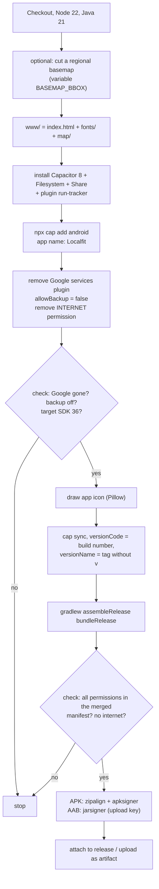

# Build and release

The app is built on GitHub. The repository contains no Android project; the build creates it from scratch on every run from `index.html`, `fonts/` and `plugins/run-tracker/`.

## When it builds

The workflow `.github/workflows/build.yml` (“Build Android”) runs

- on every **published release**. The signed APK and AAB are attached to the release.
- **manually** via the “Actions” tab, “Build Android”, “Run workflow” (choose a branch). The files are then available as the artifact `localfit-android` of that run.
- on every **pull request** against `main` (and on every new push to it). The check is called `build`. In the repository settings under Branches it can be made a required check, so nothing reaches `main` without a green build.

A run takes a few minutes. Without the signing secrets the build still runs and hands out **unsigned** files (with a warning), so forks and the very first run work.

## What the build does

### The checks

The build stops if

- `google-services` still appears in the Android project,
- `android:allowBackup="false"` is not set,
- the target SDK is not 36 (Google Play requires a current target),
- one of these permissions is missing from the merged manifest: `ACCESS_FINE_LOCATION`, `FOREGROUND_SERVICE`, `FOREGROUND_SERVICE_LOCATION`, `WAKE_LOCK`, `POST_NOTIFICATIONS`, `VIBRATE`,
- the service is not registered as `foregroundServiceType="location"`,
- the merged manifest still contains the `INTERNET` permission or `ACCESS_BACKGROUND_LOCATION` (the app needs neither),
- the signatures can't be verified.

The permission check was added after the crash in v1.6.0, see [[Low-code manifesto|Low-Code-Manifesto]], “Two cases from practice”.

## Publishing a new version

1. Merge the changes into `main`.
2. Under “Releases”, choose “Draft a new release”.
3. Create a new tag such as `v1.0.0`, target `main`.
4. Enter a title and a short description for users.
5. “Publish release”. After a few minutes `localfit.apk` and `localfit.aab` are attached to the release. Obtainium detects the update; the `.aab` is what you upload to Google Play, see [RELEASING.md](https://github.com/cyberconical/localfit/blob/main/docs/RELEASING.md).

### Version numbers

| Part | Value |
|---|---|
| `versionName` | the tag without `v`, for example `1.0.0`. For manual runs `0.0.0`. |
| `versionCode` | the workflow's running build number |

Android only installs an update if `versionCode` is higher. Because the build number always rises, this works automatically. Note that an APK from a manual run also has a higher number than an older release.

## Signing

The APK and the AAB are signed with a fixed key (the Google Play **upload key**). It is not in the code but stored as repository secrets on GitHub: `KEYSTORE_BASE64` and `KEYSTORE_PASSWORD` (Settings, Secrets and variables, Actions).

- All updates distributed outside Google Play must be signed with the same key. An installed app can't be updated with a different one. It would have to be uninstalled first, which deletes the entries.
- Keep the key and password outside GitHub as well. If they are lost, existing installations get no more updates.
- A key or password must never be in the repository, not even in older versions of files.

## Technology at a glance

| Part | Implementation |
|---|---|
| App | `index.html`, HTML, CSS and JavaScript without frameworks |
| Android shell | Capacitor 8, app ID `io.github.cyberconical.localfit` |
| Capacitor plugins | `@capacitor/filesystem`, `@capacitor/share`, own `run-tracker` |
| Build | GitHub Actions, Node 22, Java 21, Gradle; output `localfit.apk` (direct install) and `localfit.aab` (Google Play) |
| Minimum / target version | Android 7.0 (API 24) / Android 16 (API 36) |
| License | GPL-3.0-or-later |

## Wiki

This wiki lives in the repository under `docs/wiki/`. The workflow `wiki.yml` (“Publish wiki”) checks the internal links and publishes the pages to the GitHub wiki on every push to `main` that changes them, and can also be started manually. The wiki must exist once: create the first page in the “Wiki” tab (any content). See [[Contributing and testing|Contributing-and-Testing]].
